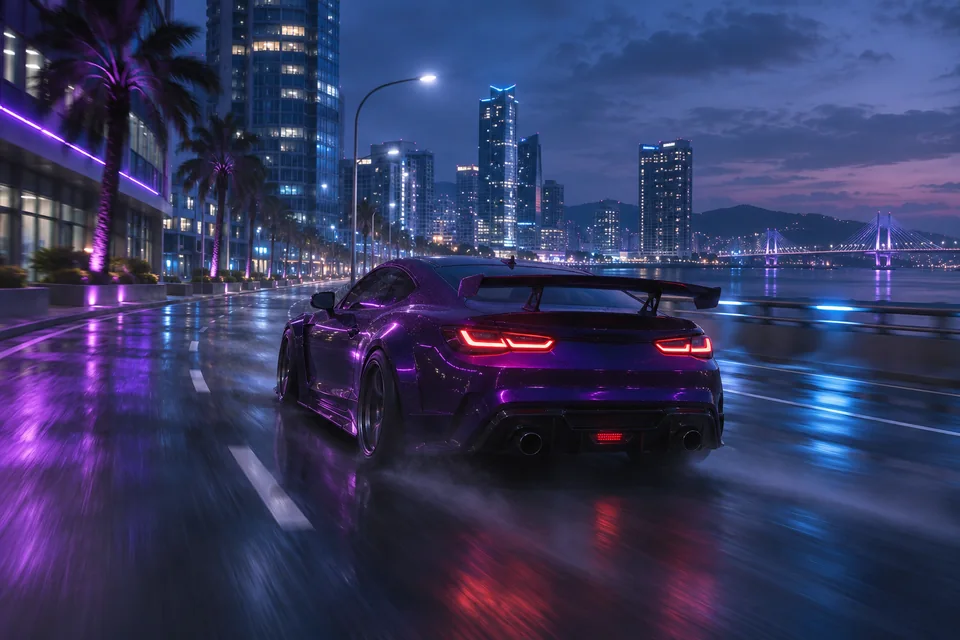

# Clip Desk

Clip Desk is an open-source Windows workspace by [DroMeta](https://x.com/DroMeta) for capturing, editing, and publishing vertical clips from Twitch and Kick. Capture a live moment, review the facecam and captions, and export a finished 9:16 video.

[Download for Windows](https://cliprdesk.vercel.app/downloads) | [Workflow guide](WORKFLOWS.md) | [Security policy](SECURITY.md) | [MIT License](LICENSE)



## Quick start

1. Download the Windows ZIP and extract it to a local folder outside cloud sync.
2. Run `setup.bat`. You need Windows x64, Python 3.12 or later, and FFmpeg. The setup offers to install tools you are missing.
3. Run `start.bat` and open **Creator channels**. Add a Twitch or Kick channel, confirm permission, then enable clipping.
4. The buffer starts when the enabled channel goes live. Use **Clip moment** to capture the seconds around a highlight, or let chat activity trigger a clip. Open **Creator clips** to review and export.

See [Windows installation and updates](README.txt) for checksum verification and update instructions. The Windows workspace opens at [127.0.0.1:8788](http://127.0.0.1:8788/today) by default.

## Workspaces

| Workspace | What you can do |
| --- | --- |
| **Creators** | Capture your own or authorized Twitch and Kick streams, import highlights from an enabled creator's public Twitch VOD, and prepare clips for manual publishing. |
| **GTA 6** | Manage the GTA watchlist, review and score branded clips, and configure optional TikTok publishing, trend research, and eligible Whop rewards. |

New installations have an empty watchlist and automatic posting disabled. Clip Desk runs on loopback. Provider accounts and an optional AI service are configured by each user in **Setup**. Publishing requires locally recorded permission. See [creator rights](OPEN-SOURCE.md) and the [provider workflow guide](WORKFLOWS.md).

## Development

Use an isolated Windows checkout with no real `.env` or footage.

```text
python -m venv .venv
.venv\Scripts\activate
python -m pip install --require-hashes -r requirements.txt
python -m pip install --require-hashes --no-deps -r requirements-media.txt
python -m pip install -r requirements-test.txt
python build_worker.py
python -m unittest discover -s tests
python -m unittest discover -s web/tests
```

Preview the public site with `python -m uvicorn web.app:app --host 127.0.0.1 --port 8791`. See [CONTRIBUTING.md](CONTRIBUTING.md) for changes and reporting.

## License

Copyright (c) 2026 DroMeta (DroHadTo on GitHub). The original Clip Desk code is licensed under the [MIT License](LICENSE). Retain the copyright and license notice when distributing it. See [THIRD-PARTY-NOTICES.md](THIRD-PARTY-NOTICES.md) for bundled components. Footage, music, names, and trademarks are covered by their respective rights and permissions.
